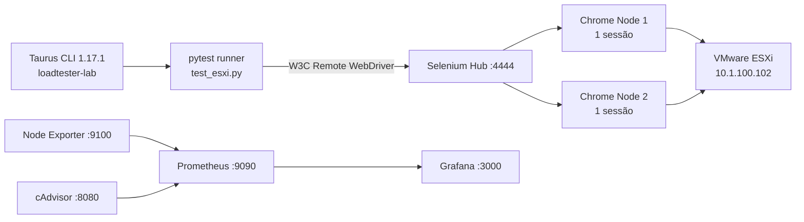

# seleniumBlazerMeter

Repositório de prova de conceito (PoC) com duas trilhas independentes: **testes funcionais do PAE Ambulante com Selenium** e **campanha histórica de carga funcional da aplicação VMware ESXi com Taurus, Selenium Grid e Chrome**. A infraestrutura utiliza Docker e inclui coleta de métricas por Prometheus, cAdvisor e Node Exporter, com visualização no Grafana. Os resultados e limites de cada trilha são documentados separadamente.

## Baseline operacional e divergências

A fotografia do runtime observada em 24/11/2026, incluindo a matriz de divergências em relação aos arquivos versionados e os critérios de evidência da próxima campanha, está em [docs/BASELINE_OPERACIONAL_2026-11-24.md](docs/BASELINE_OPERACIONAL_2026-11-24.md). Essa baseline é experimental e não representa homologação de capacidade para produção.

## Arquitetura

A arquitetura funcional atual e suas limitações estão descritas em [docs/ARQUITETURA_ATUAL.md](docs/ARQUITETURA_ATUAL.md). O diagrama abaixo representa especificamente a campanha histórica Taurus/ESXi de 04/11/2026; ele não representa o fluxo funcional do PAE.



- **Taurus**: orquestra a campanha, controla concorrência, ramp-up e duração, e agrega estatísticas.
- **pytest**: runner explícito do Taurus para executar o script Python; o teste é implementado como `unittest.TestCase`, compatível com descoberta pelo pytest.
- **Selenium WebDriver W3C**: cria sessões remotas no endpoint canônico do Grid.
- **Selenium Hub**: distribui sessões pelos Nodes disponíveis.
- **Chrome Nodes**: executam o Chrome headless; cada Node aceita uma sessão simultânea (`SE_NODE_MAX_SESSIONS=1`).
- **Docker Compose**: mantém os serviços na rede `e03_selenium-grid`; `init: true` nos Nodes faz o `docker-init` atuar como PID 1 e recolher processos filhos.
- **cAdvisor → Prometheus → Grafana**: coleta e apresenta métricas dos containers. O Node Exporter também é alvo do Prometheus (`node-exporter:9100`). A validação do runtime mostrou que algumas fontes do kernel (`/proc/meminfo`, `/proc/stat` e os três campos de load average de `/proc/loadavg`) correspondem aos dados globais observados no host; já `df -hT` apresenta a visão de filesystem do container (`overlay`/`tmpfs`), não o inventário do host. Portanto, a interpretação das séries `node_*` deve ser feita por coletor, conforme [a validação de observabilidade](docs/ARQUITETURA_ATUAL.md#43-limites-de-interpretação-das-métricas). O arquivo `prometheus.yml` configura os três alvos: `node-exporter:9100`, `cadvisor:8080` e `prometheus:9090`.

Caminho da campanha histórica Taurus/ESXi: `Taurus → pytest → Selenium WebDriver → Selenium Hub → Chrome Node → Chrome → ESXi`. A trilha funcional PAE é independente e está documentada em [docs/PAE_CICLO_01.md](docs/PAE_CICLO_01.md).

## Ambiente homologado

| Item | Valor |
|---|---|
| Host de execução | `loadtester-lab` |
| Sistema operacional | Debian GNU/Linux 13 (trixie) |
| CPU / memória | 2 vCPUs / 3,8 GiB RAM (relato do host) |
| Taurus | 1.17.1 |
| Aplicação alvo | `https://10.1.100.102/` |
| Grid | Selenium 4, Hub + 2 Chrome Nodes |
| Concorrência | 2 usuários virtuais / 2 sessões |
| Estratégia de carregamento | `page_load_strategy = "eager"` |
| Janela | 04/11/2026, 11:32:06–11:35:48 |
| Duração informada | 03min27s |
| Exit code Taurus | `0` |

> **Nota sobre a duração:** 11:32:06–11:35:48 corresponde aritmeticamente a **3min42s**, enquanto o dossiê informa **3min27s**. Esta revisão não escolhe um dos valores sem o log original do Taurus. Para análises temporais, usar o timestamp do log como fonte primária e corrigir este registro após conferência.

## Recursos e contenção da VM

A VM de referência possui **2 vCPUs e 4 GB de RAM**. Os limites individuais de CPU declarados no Compose somam **2,25 vCPU** (node-exporter 0,15; cAdvisor 0,10; Prometheus 0,30; Grafana 0,20; Hub 0,30; Chrome Node 1 0,60; Chrome Node 2 0,60). Esses valores são **limites máximos individuais, não reservas dedicadas**; o Docker pode compartilhar CPU e haverá contenção quando a demanda simultânea superar a capacidade da VM. Isso é uma característica do ambiente PoC, não uma alegação de capacidade para cargas maiores.

### Memória compartilhada do Chrome

O Compose configura `shm_size: 512mb` em cada Chrome Node. O script Selenium também usa `--disable-dev-shm-usage`, que instrui o Chrome a evitar o `/dev/shm` convencional e utilizar um diretório temporário alternativo. Portanto, o valor de `shm_size` não deve ser interpretado isoladamente como a memória efetivamente utilizada pelo navegador. A configuração é mantida como parte do ambiente reportado; alterações devem ser avaliadas por nova execução funcional.

## Resultado homologado — campanha de 04/11/2026

| Métrica | Resultado |
|---|---:|
| Amostras (samples) | **63** |
| Sucessos | **63** |
| Falhas | **0** |
| Taxa de falha | **0,00%** |
| Tempo médio | **6,239 s** |
| Tempo mínimo | **3,303 s** |
| P50 / mediana | **5,204 s** |
| P90 | **9,048 s** |
| P95 | **11,824 s** |
| P99 | **22,432 s** |
| Tempo máximo | **22,445 s** |
| Exit code | **0 — Done performing** |

Os percentis são estatísticas reportadas pelo Taurus para o label `test_access_esxi`. Eles representam os tempos das amostras funcionais reportadas pela campanha; não devem ser confundidos com percentis de latência HTTP de um teste de protocolo, nem com métricas calculadas pelo Prometheus.

### Rastreabilidade e interpretação dos resultados

Os indicadores acima foram conferidos com o arquivo de amostras da execução:

`/home/edsonc/2026-11-04_11-32-06.912938/apiritif.0.csv`

A validação encontrou 63 amostras bem-sucedidas e nenhuma falha. Os percentis foram reproduzidos utilizando o algoritmo `SinglePassIterator` do Taurus 1.17.1 e HdrHistogram, com os seguintes resultados: P50 5,204 s, P90 9,048 s, P95 11,824 s e P99 22,432 s.

**Nota de correção documental:** os percentis anteriormente registrados (P50 5,840 s, P90 8,120 s, P95 9,450 s e P99 11,210 s), assim como os tempos mínimo e máximo anteriormente publicados, não foram reproduzidos a partir do CSV identificado. Sua origem permanece sem confirmação. Eles não devem ser atribuídos a esta execução sem a localização da respectiva evidência primária.

O resultado comprova a execução bem-sucedida desta campanha com dois usuários virtuais. **Não comprova capacidade homologada para concorrência superior, nem capacidade máxima do Grid ou do host.**

## Auditoria pós-carga — 04/11/2026

O relatório fornecido para a execução de `check_poc_environment.sh` registrou:

| Verificação | Resultado reportado |
|---|---|
| Debian 13 trixie | PASS |
| Docker Engine 26.1.5+dfsg1 | PASS |
| Acesso ao socket Docker sem sudo | PASS |
| Selenium Hub `ready=true` | PASS |
| Nodes registrados | 2 |
| PID 1 via `docker-init` nos dois Nodes | PASS |
| Processos zombies nos Nodes | 0 |
| Node Exporter `/metrics` | PASS |
| cAdvisor `/metrics` | PASS |
| Prometheus targets | Todos `UP` |
| Chrome Node → ESXi | HTTP 200 |

O resultado demonstra ambiente operacional e ausência de zombies no instante da auditoria pós-carga. É uma observação pontual pós-campanha, não uma garantia de ausência de zombies em todas as execuções futuras.

## Consultas PromQL homologadas no dossiê

### cAdvisor — containers e Chrome Nodes

**Uso de CPU por Chrome Node (% de um core):**

```promql
sum(rate(container_cpu_usage_seconds_total{name=~"chrome-node.*"}[1m])) by (name) * 100
```

**Memória working set dos Chrome Nodes (MiB):**

```promql
container_memory_working_set_bytes{name=~"chrome-node.*"} / 1024 / 1024
```

**Containers de teste observados recentemente:**

```promql
count by (name) (container_last_seen{name=~"chrome-node.*|selenium-hub"})
```

### Node Exporter — interpretação das séries `node_*`

> **Resultado da validação do runtime:** o Node Exporter executa em container com namespaces PID e cgroup privados, sem mounts explícitos dos diretórios do host e com limite de memória de 64 MiB (limite configurado de memória + swap: 128 MiB). Apesar desse isolamento, as leituras comparativas mostraram correspondência de fontes globais do kernel: `MemTotal` e `SwapTotal` idênticos aos do host, valores dinâmicos de memória/swap muito próximos, contadores agregados de CPU de `/proc/stat` próximos e os três campos de load average de `/proc/loadavg` iguais. Os campos finais de tarefas/PID de `/proc/loadavg` diferem.
>
> **Limite confirmado:** `df -hT` dentro do container apresenta `overlay` e `tmpfs`, não a visão do filesystem raiz do host (`/dev/sda1` em `/`). Assim, `node_filesystem_*` não está validado como inventário do host. As métricas de rede também não foram comparadas com as interfaces do host, e `node_uname_info` identificou o hostname do container. A validação é específica às fontes e ao snapshot observado; não autoriza generalizar para todas as séries `node_*`.

**Load average de 1 minuto:**

```promql
node_load1
```

**Load average de 5 minutos:**

```promql
node_load5
```

**Memória física usada (MiB), calculada como total menos disponível:**

```promql
(node_memory_MemTotal_bytes - node_memory_MemAvailable_bytes) / 1024 / 1024
```

**Disponibilidade dos alvos de monitoramento:**

```promql
up{job=~"node-exporter|cadvisor|prometheus"}
```

> As expressões acima são as consultas registradas no dossiê histórico da campanha. As séries `container_*` dependem da configuração de coleta do cAdvisor e dos labels efetivamente expostos. A consulta `up` indica disponibilidade dos alvos de scraping, não comprova a correção semântica das métricas. A validação comparativa de `/proc` sustenta a interpretação de memória, swap, CPU agregada e load average global no snapshot observado; não valida `node_filesystem_*`, métricas de rede ou todas as séries `node_*`. Validar os resultados no Prometheus após alterações de versão ou configuração.

## Configuração e execução

Arquivos principais na raiz:

- `docker-compose.yml` — Hub, dois Chrome Nodes, Node Exporter, cAdvisor, Prometheus e Grafana.
- `prometheus.yml` — configuração de scraping para Prometheus.
- `check_poc_environment.sh` — auditoria pré/pós-carga.
- `test_esxi.py` — teste Selenium remoto para o console ESXi.
- `taurus-esxi-poc.yml` — cenário Taurus com concorrência 2, ramp-up 20s e hold-for 3m.
- `README.md` — arquitetura e registro da homologação.

### Pré-requisitos

- Docker Engine e Docker Compose plugin instalados.
- `curl`, `jq`, `ps` e `pgrep` no host; `curl` e `ps` disponíveis nos Chrome Nodes para os checks correspondentes.
- Taurus CLI 1.17.1 e dependências Python do Selenium/pytest no host `loadtester-lab`.
- Rota de rede do Chrome Node para `10.1.100.102`.
- Os arquivos `docker-compose.yml` e `prometheus.yml` devem permanecer no mesmo diretório para que o bind mount relativo de configuração seja resolvido corretamente.

### Subir a infraestrutura

```bash
docker compose -f docker-compose.yml config
docker compose -f docker-compose.yml up -d
```

### Auditar o ambiente

```bash
chmod +x check_poc_environment.sh
./check_poc_environment.sh
```

### Executar a campanha

O manifesto usa o caminho absoluto homologado no host:

```bash
bzt taurus-esxi-poc.yml
```

O script deve estar em `/home/edsonc/test_esxi.py` no `loadtester-lab`. O Grid é acessado pelo host em `http://127.0.0.1:4444`.

## Decisões e limites conhecidos

1. `init: true` permanece habilitado nos dois Chrome Nodes para fornecer um processo init como PID 1.
2. `shm_size: 512mb` é o valor presente no `docker-compose.yml` fornecido para esta atualização. O registro histórico de 22/09/2026 menciona `2gb`; há, portanto, uma divergência documental que deve ser reconciliada com o Compose efetivamente usado na campanha antes de afirmar que o valor de SHM foi homologado em 04/11/2026.
3. Os limites `cpus` e `mem_limit` são declarados diretamente nos serviços Compose.
4. O serviço cAdvisor é privilegiado e expõe a porta 8080; restringir a exposição à rede administrativa/host firewall conforme a política operacional do ambiente.
5. As portas 9100, 8080, 9090, 3000 e 444x devem ser protegidas por firewall quando o host estiver em rede compartilhada.
6. A auditoria verifica HTTP 200 do ESXi; se a aplicação passar a responder legitimamente com redirecionamento, ajustar o critério de forma explícita, sem aceitar qualquer status como sucesso.
7. O script de auditoria reporta Firefox como aviso, pois o processo do operador compete por CPU/memória com a campanha.

## Histórico anterior — 22/09/2026

A documentação anterior registrou a correção do problema histórico de processos `[sh] <defunct>` associados ao Fluxbox/`fbsetbg`, reconstrução do Grid com Selenium `4.48.0-20260905`, dois Nodes, `init: true`, rede dedicada `e03_selenium-grid`, Xvfb ativo, VNC/noVNC desabilitados e zero zombies no baseline e após uma campanha controlada de sessões.

O status de 22/09/2026 registra `shm_size: 2gb`; o manifesto atualizado aqui traz `512mb`, conforme o artefato recebido. Essa diferença está destacada acima para não misturar duas configurações distintas.

Evidências históricas locais:
- `evidence/rebuild-final/`
- `evidence/session-campaign/`

## Próximos marcos

- Reconciliar o valor de `shm_size` com a configuração executada na campanha oficial.
- Arquivar o relatório integral do Taurus, os logs da auditoria e snapshots de estado do Grid/processos junto à campanha.
- Repetir campanhas em níveis progressivos de concorrência antes de declarar limites de capacidade acima de 2 VUs.
- Correlacionar percentis Taurus, ocupação dos slots, CPU/memória dos Nodes e estados pré/pós-sessão.

## Referências

- [Arquitetura atual e limites observados](docs/ARQUITETURA_ATUAL.md)
- [Plano e evidências do PAE — Ciclo 01](docs/PAE_CICLO_01.md)
- [Taurus — Selenium Executor](https://gettaurus.org/docs/Selenium/)
- [Taurus — Execution Settings](https://gettaurus.org/docs/ExecutionSettings/)
- [Docker Compose Specification](https://compose-spec.io/)
- [Selenium Grid](https://www.selenium.dev/documentation/grid/)
- [Matriz_de_fontes](./Matriz_de_fontes)
- A matriz reúne referências Context7 e critérios para consulta, compatibilidade de versões e validação técnica.

---

## PAE — automacao funcional (Ciclo 01)

O projeto passa a incluir uma trilha funcional independente para o ambiente
de desenvolvimento do PAE Ambulante. O primeiro ciclo cobre Login Unico,
portal de servicos, cartao `card_pae_ambulante` e chegada a
`/Solicitacao/Local`.

- Plano e casos do ciclo: [docs/PAE_CICLO_01.md](docs/PAE_CICLO_01.md).
- Execucao requer Selenium Grid ativo e autenticacao manual pelo noVNC.
- Nenhum CPF ou senha e armazenado pelo teste.
- Nenhum cadastro, envio de documento ou solicitacao de vaga e realizado.
- Ciclo 01 homologado em 13/11/2026: 1 teste funcional aprovado.
- Resultado: `1 passed` em 96,22 segundos.
- A autenticacao do Login Unico e manual pelo operador via noVNC.
- Os cinco casos CT-PAE-001 a CT-PAE-005 foram verificados.
- Evidencias, limites e correcao do seletor estao em
  [docs/PAE_CICLO_01.md](docs/PAE_CICLO_01.md).
- `test_esxi.py` e `taurus-esxi-poc.yml` permanecem preservados como trilha
  historica da POC ESXi/Taurus.
- A campanha Taurus homologada nao foi alterada: 2 VUs, ramp-up de 20s,
  hold-for de 3m. Este ciclo nao inicia campanha de carga.

Para executar o teste manual:

```bash
PYTHONPATH="/home/edsonc/.bzt/python-packages/3.13.5" \\
python3 -m pytest -m pae_manual_auth -s -v \\
  tests/functional/test_acesso_pae.py
```

## Dashboards Grafana — Fase 03

Foram criados e importados três dashboards novos e independentes para a PoC, preservando os três dashboards originais existentes no Grafana:

- **PoC - Selenium Grid & Infraestrutura — Fase 03** (`poc-selenium-operacional`): visão operacional de endpoints de scrape, CPU e memória do host e dos containers — 6 painéis.
- **Investigação de Recursos - Selenium Grid & Host** (`poc-taurus-investigacao`): investigação de CPU, I/O wait e memória — 7 painéis.
- **QAOps - Resultados e Capacidade** (`qaops-capacidade-correlacao`): contexto de infraestrutura para QAOps; permanece parcial até a integração dos resultados Taurus — 6 painéis.

Os três dashboards utilizam o datasource Prometheus existente (`cg3adtrifq7lse`). A inspeção visual após a importação confirmou dados nos 19 painéis, sem erros visíveis de renderização ou datasource. A inspeção dos JSONs exportados identificou 20 targets/expressões PromQL.

O indicador `up` representa o sucesso da coleta do endpoint, não a prontidão funcional do Selenium Grid. A memória dos containers é apresentada como working set do cgroup, não RSS. O Prometheus ainda não coleta métricas do Selenium Hub ou Taurus; portanto, sessões ativas, VUs, throughput, latência, percentis e taxa de erro não estão disponíveis como métricas em tempo real.

As exportações pós-importação de 17/11/2026 e seus checksums SHA-256 estão registrados em `dashboards/exports/grafana-2026-11-17/`. Os detalhes de consultas, validação, arquivos e limitações estão em [`dashboards/generated/FASE_03_DASHBOARDS.md`](dashboards/generated/FASE_03_DASHBOARDS.md).

**Estado:** criação, importação, inspeção visual e exportação concluídas. A integração das métricas Taurus e do Selenium Hub, a correlação temporal automatizada e a homologação de capacidade permanecem pendentes. A conclusão da Fase 03 não representa homologação de capacidade máxima do ambiente.
