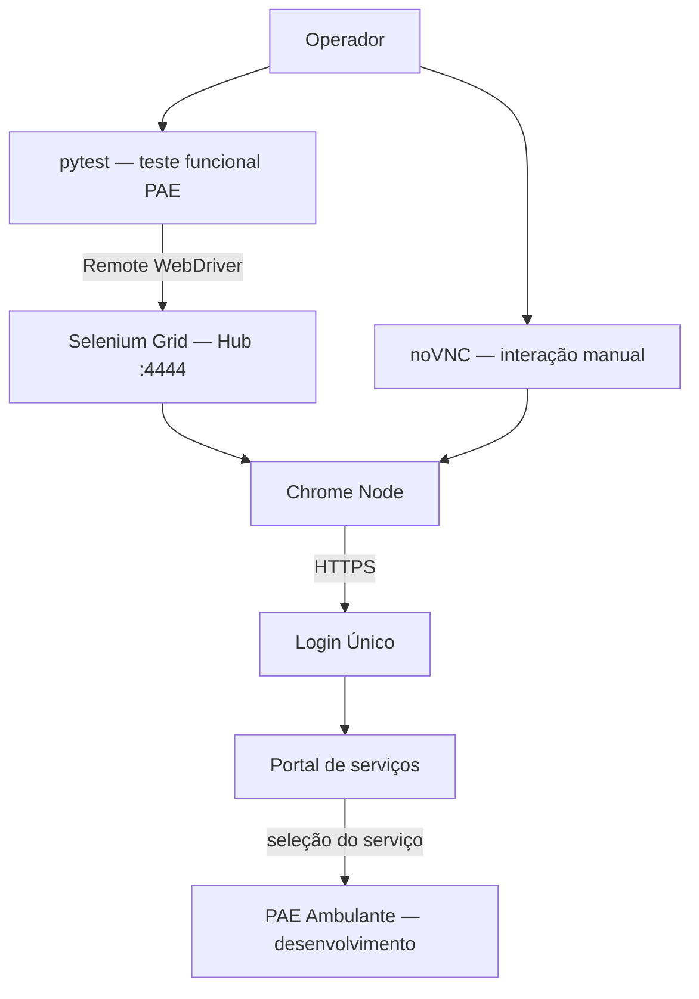
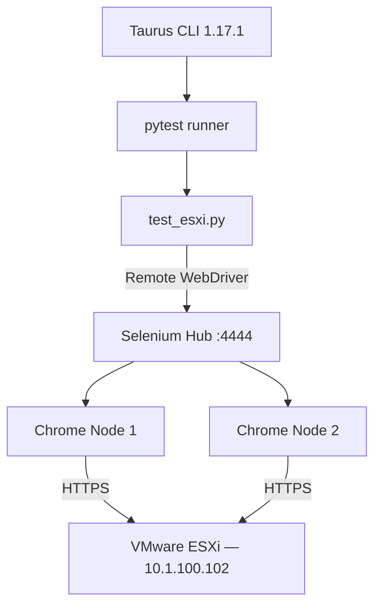

# Arquitetura atual do PoC

## 1. Escopo

O projeto possui duas trilhas distintas:

- **Trilha funcional atual:** automação de acesso ao PAE Ambulante,
  passando pelo Login Único, portal de serviços e página inicial do PAE.
- **Trilha histórica de carga:** campanha Taurus/Selenium realizada
  em 04/11/2026 contra o VMware ESXi.

A campanha histórica não representa um teste de carga do PAE.

A infraestrutura Docker fornece o Selenium Grid e os componentes de
observabilidade utilizados ou mantidos pela PoC. A configuração versionada
no repositório deve ser distinguida do runtime observado na VM, pois foram
identificadas diferenças entre os dois.

## 2. Fluxo funcional atual — PAE

A autenticação é realizada manualmente pelo operador no navegador remoto,
por meio do noVNC. O teste Selenium utiliza uma sessão remota no Grid e
verifica o acesso ao serviço.

O ciclo funcional homologado contempla:

1. Acesso manual ao Login Único.
2. Chegada ao portal de serviços.
3. Identificação do cartão `card_pae_ambulante`.
4. Verificação do endereço de destino do serviço.
5. Abertura do PAE Ambulante na página `/Solicitacao/Local`.

O ciclo não preenche credenciais, realiza cadastro, envia documentos ou
solicita vaga.

## 3. Trilha histórica de carga — Taurus/ESXi

Esta trilha documenta a campanha homologada em 04/11/2026.
Ela permanece no repositório como referência histórica e não representa
a execução funcional atual do PAE.

O fluxo de execução foi:

1. Taurus CLI 1.17.1 orquestrou a campanha.
2. O Taurus utilizou o pytest como executor.
3. O teste `test_esxi.py` criou sessões remotas pelo Selenium WebDriver.
4. O Selenium Hub distribuiu as sessões entre dois Chrome Nodes.
5. Os navegadores acessaram a interface VMware ESXi.

## 4. Infraestrutura de execução e monitoramento

Esta seção registra a topologia observada no ambiente Docker da VM
`loadtester-lab`. Trata-se de um levantamento do runtime, não de uma
garantia de que os arquivos versionados no repositório reproduzem
integralmente essa configuração.

### 4.1 Componentes observados

| Componente | Função |
|---|---|
| Selenium Hub | Recebe sessões WebDriver e distribui a execução |
| Chrome Node 1 e 2 | Executam sessões de navegador |
| Prometheus | Coleta e armazena séries temporais |
| Node Exporter | Expõe métricas `node_*` a partir de seu próprio contexto de execução |
| cAdvisor | Expõe métricas dos containers |
| Grafana | Apresenta dashboards e consultas de monitoramento |

Na rede Docker observada, os endereços eram:

| Componente | Endereço interno |
|---|---|
| Prometheus | `172.21.0.2` |
| Node Exporter | `172.21.0.3` |
| Grafana | `172.21.0.4` |
| Chrome Node 1 | `172.21.0.5` |
| Selenium Hub | `172.21.0.6` |
| Chrome Node 2 | `172.21.0.7` |
| cAdvisor | `172.21.0.8` |

Esses endereços pertencem ao snapshot observado e podem mudar após
recriação da rede ou dos containers.

### 4.2 Coleta do Prometheus

A configuração observada utiliza intervalo global de coleta de 10 segundos
e consulta três destinos:

- `prometheus:9090`
- `node-exporter:9100`
- `cadvisor:8080`

No levantamento realizado, os três destinos apresentaram estado `UP`.
Esse resultado confirma a disponibilidade dos endpoints de coleta naquele
momento, mas não comprova, isoladamente, a correção semântica de todas as
métricas ou sua atribuição ao host físico/virtual.

### 4.3 Limitações de interpretação das métricas

O Node Exporter observado executa em container, sem compartilhamento
configurado do namespace PID do host e sem os mounts necessários para
caracterizar suas séries como métricas comprovadas do sistema operacional
Debian da VM.

A série `node_uname_info` apresentou o hostname do próprio container.
Portanto, métricas `node_*`, incluindo carga e memória, não devem ser
apresentadas como métricas validadas do host neste cenário.

O cAdvisor expõe métricas dos containers. A série
`container_memory_working_set_bytes` representa o working set de memória
do container; não equivale à memória RSS exclusiva do processo Chrome.

A consulta de CPU baseada em
`container_cpu_usage_seconds_total` expressa percentual de um núcleo.
Em uma VM com dois vCPUs, aproximadamente 200% corresponde ao uso
equivalente a dois núcleos.

### 4.4 Diferenças entre configuração versionada e runtime

Foram identificados dois arquivos Compose distintos:

- Compose versionado no repositório: `docker-compose.yml`.
- Compose utilizado no runtime observado: `/home/edsonc/docker-compose.yml`.

Ambos passaram pela validação sintática do Docker Compose, mas isso não
significa que suas configurações sejam equivalentes.

Entre as diferenças observadas estão limites de recursos, configuração
de memória compartilhada dos Chrome Nodes e serviços presentes no runtime.
O Grafana estava em execução no ambiente observado, mas não constava como
serviço no Compose ativo utilizado nessa inspeção.

Também foi observada divergência entre a retenção efetiva do Prometheus
(2 horas) e a configuração declarada no Compose versionado (2 dias).

Consequentemente, o arquivo Compose do repositório não deve ser tratado
como reprodução comprovada do ambiente em execução.

### 4.5 Limites da cobertura de monitoramento

No levantamento registrado, não havia coleta específica configurada
para métricas internas do Selenium Hub, do VMware ESXi, da aplicação PAE
ou da VM que hospeda a aplicação.

A disponibilidade dos três targets do Prometheus não representa
monitoramento completo de todos os componentes do fluxo funcional ou
da infraestrutura de destino.

## 5. Síntese arquitetural e pendências

### 5.1 Trilhas funcionais distintas

O repositório reúne duas trilhas de trabalho que devem ser
interpretadas separadamente:

- **Trilha funcional PAE:** utiliza pytest e Selenium Grid para
  validar o acesso ao portal Login Único e a navegação até o sistema
  PAE Ambulante em ambiente de desenvolvimento. A autenticação
  permanece uma etapa manual.
- **Trilha histórica Taurus/ESXi:** registra uma campanha de carga
  controlada, executada com Taurus, pytest e Selenium Grid contra
  a interface VMware ESXi.

A campanha histórica Taurus/ESXi não representa uma campanha de
carga do PAE e seus resultados não devem ser utilizados para
caracterizar a capacidade ou o desempenho da aplicação PAE.

### 5.2 Limites de reprodutibilidade

A configuração versionada no repositório e a configuração observada
em execução apresentaram diferenças documentadas na seção 4.4.

Assim, a reprodução integral do ambiente exige uma reconciliação
prévia entre os arquivos versionados, os parâmetros efetivos dos
containers e os serviços realmente executados.

A validação sintática dos arquivos Compose, isoladamente, não
comprova equivalência operacional entre os ambientes.

### 5.3 Limites de observabilidade

A cobertura atualmente observada não permite afirmar que todos os
componentes do fluxo estejam monitorados.

Em particular, permanecem sem coleta específica comprovada:

- métricas internas do Selenium Hub;
- métricas do VMware ESXi;
- métricas da aplicação PAE;
- métricas da VM que hospeda a aplicação;
- métricas de sistema operacional do host Debian devidamente
  atribuídas e validadas.

As séries do cAdvisor devem continuar sendo interpretadas no
contexto dos containers. As séries `node_*` do Node Exporter
não devem ser tratadas como métricas validadas do host enquanto
a configuração de coleta não for corrigida e verificada.

### 5.4 Pendências para evolução

Antes de ampliar as conclusões sobre capacidade, desempenho ou
reprodutibilidade, são necessárias as seguintes atividades:

1. Reconciliar a configuração Compose versionada com a configuração
   efetivamente utilizada no runtime.
2. Validar a coleta de métricas do host Debian, com acesso explícito
   aos recursos do host e comprovação da origem das séries.
3. Avaliar a inclusão de métricas específicas do Selenium Grid,
   do ESXi e da aplicação sob teste, conforme os objetivos de cada
   campanha.
4. Preservar, para cada campanha, os arquivos de configuração,
   relatórios integrais, logs e evidências de estado da infraestrutura.
5. Executar campanhas específicas para cada sistema sob teste,
   sem extrapolar resultados obtidos em um ambiente para outro.

Essas atividades são pendências de evolução e não representam
funcionalidades já implementadas ou homologadas.
"""
