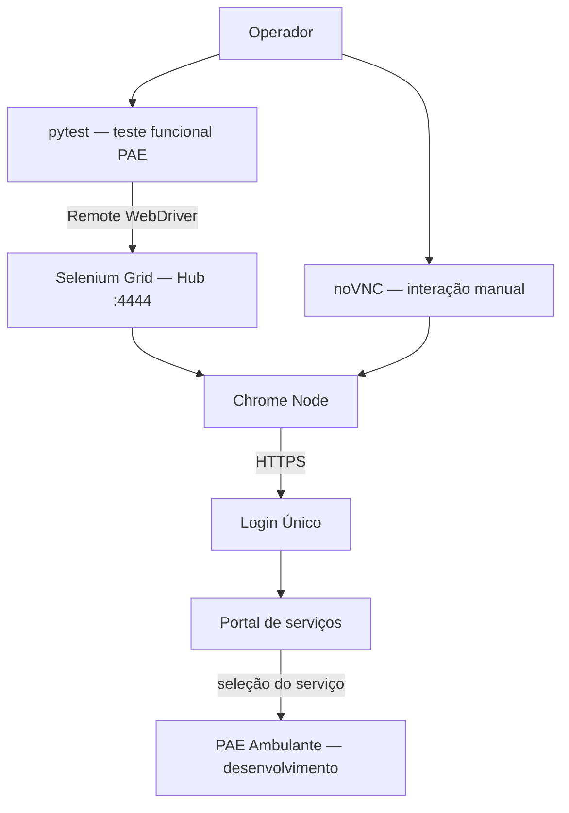
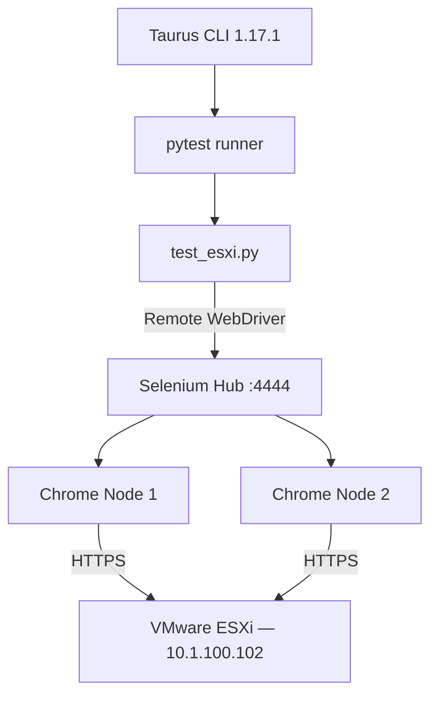

# Arquitetura atual do PoC

## 1. Escopo

O projeto possui duas trilhas distintas:

- **Trilha funcional atual:** automação de acesso ao PAE Ambulante,
  passando pelo Login Único, portal de serviços e página inicial do PAE.
- **Trilha histórica de carga:** campanha Taurus/Selenium realizada
  em 04/11/2026 contra o VMware ESXi.

A campanha histórica não representa um teste de carga do PAE.

A infraestrutura Docker fornece o Selenium Grid e os componentes de
observabilidade utilizados ou mantidos pela PoC. A configuração versionada
no repositório deve ser distinguida do runtime observado na VM, pois foram
identificadas diferenças entre os dois.

## 2. Fluxo funcional atual — PAE

A autenticação é realizada manualmente pelo operador no navegador remoto,
por meio do noVNC. O teste Selenium utiliza uma sessão remota no Grid e
verifica o acesso ao serviço.

O ciclo funcional homologado contempla:

1. Acesso manual ao Login Único.
2. Chegada ao portal de serviços.
3. Identificação do cartão `card_pae_ambulante`.
4. Verificação do endereço de destino do serviço.
5. Abertura do PAE Ambulante na página `/Solicitacao/Local`.

O ciclo não preenche credenciais, realiza cadastro, envia documentos ou
solicita vaga.

## 3. Trilha histórica de carga — Taurus/ESXi

Esta trilha documenta a campanha homologada em 04/11/2026.
Ela permanece no repositório como referência histórica e não representa
a execução funcional atual do PAE.

O fluxo de execução foi:

1. Taurus CLI 1.17.1 orquestrou a campanha.
2. O Taurus utilizou o pytest como executor.
3. O teste `test_esxi.py` criou sessões remotas pelo Selenium WebDriver.
4. O Selenium Hub distribuiu as sessões entre dois Chrome Nodes.
5. Os navegadores acessaram a interface VMware ESXi.

## 4. Infraestrutura de execução e monitoramento

Esta seção registra a topologia observada no ambiente Docker da VM
`loadtester-lab`. Trata-se de um levantamento do runtime, não de uma
garantia de que os arquivos versionados no repositório reproduzem
integralmente essa configuração.

### 4.1 Componentes observados

| Componente | Função |
|---|---|
| Selenium Hub | Recebe sessões WebDriver e distribui a execução |
| Chrome Node 1 e 2 | Executam sessões de navegador |
| Prometheus | Coleta e armazena séries temporais |
| Node Exporter | Expõe métricas `node_*`; algumas fontes `/proc` refletem dados globais do kernel, enquanto filesystem e rede dependem do namespace do container |
| cAdvisor | Expõe métricas dos containers |
| Grafana | Apresenta dashboards e consultas de monitoramento |

Na rede Docker observada, os endereços eram:

| Componente | Endereço interno |
|---|---|
| Prometheus | `172.21.0.2` |
| Node Exporter | `172.21.0.3` |
| Grafana | `172.21.0.4` |
| Chrome Node 1 | `172.21.0.5` |
| Selenium Hub | `172.21.0.6` |
| Chrome Node 2 | `172.21.0.7` |
| cAdvisor | `172.21.0.8` |

Esses endereços pertencem ao snapshot observado e podem mudar após
recriação da rede ou dos containers.

### 4.2 Coleta do Prometheus

A configuração observada utiliza intervalo global de coleta de 10 segundos
e consulta três destinos:

- `prometheus:9090`
- `node-exporter:9100`
- `cadvisor:8080`

No levantamento realizado, os três destinos apresentaram estado `UP`.
Esse resultado confirma a disponibilidade dos endpoints de coleta naquele
momento, mas não comprova, isoladamente, a correção semântica de todas as
métricas ou sua atribuição ao host físico/virtual.

### 4.3 Limitações de interpretação das métricas

O Node Exporter observado executa em container com namespace PID
privado, namespace cgroup privado (`CgroupnsMode=private`) e sem mounts
explícitos dos diretórios do host. O container possui `/proc` próprio,
`/sys` somente leitura e uma montagem cgroup v2 somente leitura. Portanto,
a origem e o escopo das métricas devem ser avaliados por coletor, e não
classificados em bloco como métricas do host ou do container.

A comparação direta entre o host e o container produziu as seguintes
evidências no snapshot inspecionado:

| Fonte/indicador | Evidência observada | Interpretação permitida |
|---|---|---|
| `/proc/meminfo` — `MemTotal` e `SwapTotal` | Valores idênticos entre host e container; `MemFree`, `MemAvailable` e `SwapFree` muito próximos em leituras sequenciais | As fontes de memória física total e swap total, assim como os valores dinâmicos observados, correspondem aos dados globais da VM nesse snapshot |
| `/proc/stat` — linha agregada `cpu` | Contadores praticamente iguais, com pequenas diferenças entre leituras sequenciais | Evidência consistente com contadores agregados de CPU do kernel compartilhado; a comparação não valida isoladamente cada série exposta pelo Prometheus |
| `/proc/loadavg` | Os três campos de load average (`1.62`, `2.56`, `2.32`) coincidiram | Os valores de load average observados correspondem ao host; os campos finais de tarefas e último PID diferiram entre os contextos |
| `df -hT` | O container mostrou raiz `overlay`, `tmpfs` e mounts internos; o host mostrou `/dev/sda1` montado em `/` | A visão de filesystem do Node Exporter é a do container; `node_filesystem_*` não está validado como inventário do filesystem do host |
| `node_uname_info` | O hostname exposto anteriormente correspondeu ao container | Não utilizar esse hostname como identificação da VM hospedeira |
| Rede | Não foi feita comparação equivalente entre interfaces do host e do container | Métricas `node_network_*` permanecem sem validação como métricas de rede do host |

As pequenas diferenças de memória e CPU são compatíveis com leituras
realizadas em sequência e com a natureza dinâmica dos contadores. Os
resultados permitem validar a correspondência das fontes globais
inspecionadas naquele momento, mas não autorizam generalizar a conclusão
para todos os coletores ou todas as séries `node_*`.

O limite de recursos observado para o Node Exporter foi `Memory=67108864`
(64 MiB) e `MemorySwap=134217728` (128 MiB como limite combinado de memória
e swap, conforme a configuração Docker inspecionada). O consumo pontual
registrado por `docker stats` foi 18,07 MiB (28,23% do limite de memória).
Esse limite é uma característica do container; não invalida por si só as
leituras globais de `/proc/meminfo`, mas deve ser acompanhado para evitar
que o próprio exporter seja encerrado por pressão de memória.

O cAdvisor expõe métricas dos containers e cgroups observados. A série
`container_memory_working_set_bytes` representa o working set de memória
do cgroup/container; não equivale à memória RSS exclusiva do processo
Chrome nem deve ser comparada diretamente ao campo `used` de `free`.

A consulta de CPU baseada em
`container_cpu_usage_seconds_total` expressa percentual de um núcleo.
Em uma VM com dois vCPUs, aproximadamente 200% corresponde ao uso
equivalente a dois núcleos.

### 4.4 Diferenças entre configuração versionada e runtime

Foram identificados dois arquivos Compose distintos:

- Compose versionado no repositório: `docker-compose.yml`.
- Compose utilizado no runtime observado: `/home/edsonc/docker-compose.yml`.

Ambos passaram pela validação sintática do Docker Compose, mas isso não
significa que suas configurações sejam equivalentes.

Entre as diferenças observadas estão limites de recursos, configuração
de memória compartilhada dos Chrome Nodes e serviços presentes no runtime.
O Grafana estava em execução no ambiente observado, mas não constava como
serviço no Compose ativo utilizado nessa inspeção.

Também foi observada divergência entre a retenção efetiva do Prometheus
(2 horas) e a configuração declarada no Compose versionado (2 dias).

Consequentemente, o arquivo Compose do repositório não deve ser tratado
como reprodução comprovada do ambiente em execução.

### 4.5 Limites da cobertura de monitoramento

No levantamento registrado, não havia coleta específica configurada
para métricas internas do Selenium Hub, do VMware ESXi, da aplicação PAE
ou da VM que hospeda a aplicação.

A disponibilidade dos três targets do Prometheus não representa
monitoramento completo de todos os componentes do fluxo funcional ou
da infraestrutura de destino.

## 5. Síntese arquitetural e pendências

### 5.1 Trilhas funcionais distintas

O repositório reúne duas trilhas de trabalho que devem ser
interpretadas separadamente:

- **Trilha funcional PAE:** utiliza pytest e Selenium Grid para
  validar o acesso ao portal Login Único e a navegação até o sistema
  PAE Ambulante em ambiente de desenvolvimento. A autenticação
  permanece uma etapa manual.
- **Trilha histórica Taurus/ESXi:** registra uma campanha de carga
  controlada, executada com Taurus, pytest e Selenium Grid contra
  a interface VMware ESXi.

A campanha histórica Taurus/ESXi não representa uma campanha de
carga do PAE e seus resultados não devem ser utilizados para
caracterizar a capacidade ou o desempenho da aplicação PAE.

### 5.2 Limites de reprodutibilidade

A configuração versionada no repositório e a configuração observada
em execução apresentaram diferenças documentadas na seção 4.4.

Assim, a reprodução integral do ambiente exige uma reconciliação
prévia entre os arquivos versionados, os parâmetros efetivos dos
containers e os serviços realmente executados.

A validação sintática dos arquivos Compose, isoladamente, não
comprova equivalência operacional entre os ambientes.

### 5.3 Limites de observabilidade

A cobertura atualmente observada não permite afirmar que todos os
componentes do fluxo estejam monitorados.

Em particular, permanecem sem coleta específica comprovada:

- métricas internas do Selenium Hub;
- métricas do VMware ESXi;
- métricas da aplicação PAE;
- métricas da VM que hospeda a aplicação;
- métricas de filesystem e rede do host Debian pelo Node Exporter;
- validação individual das demais séries e coletores `node_*` no Prometheus.

As fontes globais de memória, swap, CPU agregada e load average foram
comparadas diretamente com o host e apresentaram correspondência no
snapshot documentado na seção 4.3. Essa evidência não valida o filesystem,
a rede, o hostname ou todas as demais métricas do Node Exporter. As séries
do cAdvisor devem continuar sendo interpretadas no contexto dos cgroups
e containers observados.

### 5.4 Pendências para evolução

Antes de ampliar as conclusões sobre capacidade, desempenho ou
reprodutibilidade, são necessárias as seguintes atividades:

1. Reconciliar a configuração Compose versionada com a configuração
   efetivamente utilizada no runtime.
2. Validar individualmente as séries de filesystem e rede do host Debian;
   caso sejam necessárias, avaliar configuração explícita do Node Exporter
   para observar os mounts, a raiz de filesystem e as interfaces do host.
3. Conferir no Prometheus as séries efetivamente expostas por cada coletor,
   correlacionando-as com as fontes do host e do container.
4. Avaliar a inclusão de métricas específicas do Selenium Grid, do ESXi e
   da aplicação sob teste, conforme os objetivos de cada campanha.
5. Preservar, para cada campanha, os arquivos de configuração,
   relatórios integrais, logs e evidências de estado da infraestrutura.
6. Executar campanhas específicas para cada sistema sob teste,
   sem extrapolar resultados obtidos em um ambiente para outro.

Essas atividades são pendências de evolução e não representam
funcionalidades já implementadas ou homologadas.
"""

## 6. Arquitetura-alvo para replicação em ambientes distintos

A arquitetura de referência separa a VM geradora de testes do servidor/ambiente que hospeda a aplicação sob teste. O destino não é fixado ao VMware ESXi: representa o ambiente de hospedagem escolhido pela equipe responsável pela aplicação.

    VM geradora
    Taurus + pytest + Selenium Client
                 |
                 | WebDriver remoto / HTTP
                 v
             Selenium Hub
                 |
            +----+----+
            v         v
       Chrome Node 1  Chrome Node 2
            |         |
            +----+----+
                 |
                 | HTTPS
                 v
    Servidor / ambiente de hospedagem
            Aplicação sob teste

O ambiente de destino poderá ser desenvolvimento, treinamento ou produção. A POC atual utiliza o PAE Ambulante em desenvolvimento como aplicação sob teste. A aplicação e o ambiente são parâmetros de destino; não devem ser confundidos com o gerador de testes nem com o Selenium Grid.

A aprovação da POC não significa, isoladamente, que a infraestrutura esteja dimensionada para produção em escala. A implantação produtiva deverá ser precedida de dimensionamento e homologação específicos, incluindo capacidade, disponibilidade, segurança, rede, observabilidade e critérios de interrupção.

## 7. Execução paralela funcional PAE

A configuração inicial taurus-pae-parallel.yml, com concurrency 2 e pytest-xdist, fez os dois testes pytest concluírem, mas o plugin de gravação do runner pytest do Taurus falhou ao processar os relatórios com AttributeError: NoneType.status. O LDJSON resultante ficou incompleto; por isso, essa configuração não deve ser usada como executor aprovado.

A alternativa comprovada consiste em dois processos Taurus independentes, cada um com concorrência 1 e um módulo de teste específico. O Selenium Grid continua responsável por alocar as sessões aos Nodes disponíveis. A alocação A/B em Nodes distintos não é forçada pelo teste.

O orquestrador run_pae_parallel.sh inicia ambos os processos, preserva logs e relatórios individuais e exige uma amostra PASSED correspondente a cada caso, além de verificar que não restaram sessões ativas no Grid. A execução exige autenticação manual em cada navegador pelo noVNC.

Esta modalidade comprova execução funcional paralela de duas sessões com autenticação manual. Não é campanha de carga sustentada e não mede latência HTTP, throughput ou capacidade máxima. Os tempos Taurus incluem o fluxo funcional e a espera pela autenticação manual.

Consulte docs/PAE_EXECUCAO_PARALELA.md para instruções e evidências.
